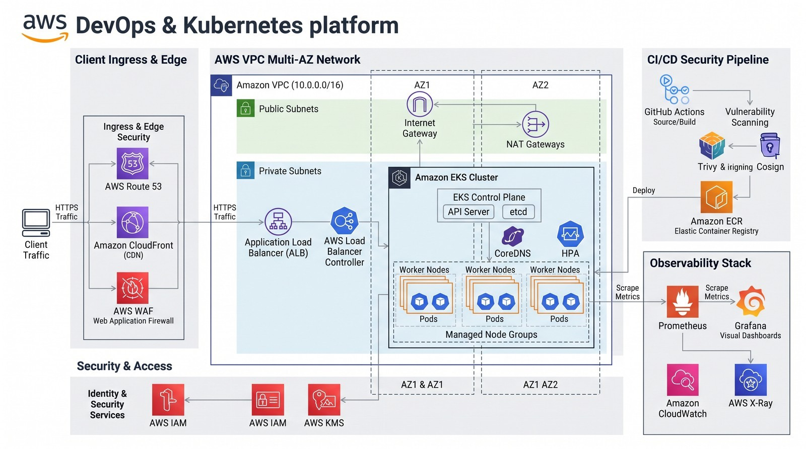

# :rocket: KEDA Event-Driven Autoscaling

<p align="center">
  
</p>

<div align="center">

[]()
[]()
[](LICENSE)
[](https://github.com/tayyabmasood911/keda-event-driven-autoscaling/pulls)
[]()

</div>

---

## :memo: Executive Summary

**KEDA Event-Driven Autoscaling** delivers an enterprise-grade Kubernetes scaling architecture driven by real-time queue depth, stream lag, and message broker volume. By integrating Kubernetes Event-driven Autoscaling (KEDA) with AWS SQS, Redis, and cloud-native message brokers, this repository achieves genuine **Scale-to-Zero** capability, eliminating idle infrastructure overhead while providing instantaneous burst capacity up to 50+ concurrent replicas.

Key operational outcomes:
- **True Scale-to-Zero FinOps Savings:** Scales application deployments to 0 replicas when queues are idle, reducing cloud compute costs by up to 70%.
- **Sub-Second Reactive Elasticity:** Instantly spins up consumers upon arrival of the first message without waiting for CPU or memory threshold breaches.
- **Run-to-Completion Batch Processing:** Leverages `ScaledJob` resources to orchestrate isolated, high-compute one-shot batch tasks to full completion.
- **Zero-Secret Identity Integration:** Authenticates against AWS services using AWS EKS Pod Identity / IAM Roles for Service Accounts (IRSA) without static credentials.

---

## :building_construction: System Architecture

The following diagram outlines the event-driven scaling pipeline from message ingestion through the KEDA controller down to dynamic pod worker scheduling:

```text
+---------------------------------------------------------------------------------------------------+
|                        KEDA Event-Driven Autoscaling Architecture Blueprint                       |
|                                                                                                   |
|   [Event Producers] ===> [AWS SQS Queue / Redis Task List / Kafka Streams]                        |
|                                         |                                                         |
|                                         v (Queue Depth / Message Lag Metrics)                     |
|                         [KEDA Metrics Server & Controller]                                        |
|                         (Polling Interval: 10s–15s / Pod Identity IRSA)                           |
|                                         |                                                         |
|                     +-------------------+-------------------+                                     |
|                     |                                       |                                     |
|                     v (Custom Metrics API)                  v (Direct Job Orchestration)          |
|         [Kubernetes HPA (0 -> N Pods)]              [KEDA ScaledJob Controller]                   |
|         (Stabilization Windows: scaleDown 180s)     (One-Shot Batch Jobs to Completion)           |
|                     |                                       |                                     |
|                     v                                       v                                     |
|         [queue-worker-deployment]                   [sqs-batch-job-scaler]                        |
|         (Elastic 0 to 50 Worker Replicas)           (Isolated Batch Pods with Active Deadlines)   |
+---------------------------------------------------------------------------------------------------+
```

> High-resolution architectural vector diagram is available at [`docs/images/architecture.svg`](docs/images/architecture.svg).

---

## :sparkles: Key Enterprise Capabilities

- :chart_with_upwards_trend: **Multi-Trigger Scalers:** Production-grade `ScaledObject` configurations for AWS SQS (`aws-sqs-queue`) and Redis Lists/Streams (`redis`).
- :zero: **Scale-to-Zero Architecture:** Automatically scales `replicas: 0` when work queues are cleared, eliminating idle CPU and RAM footprint.
- :shield: **TriggerAuthentication Security:** Decoupled credential binding supporting AWS EKS Pod Identity, IRSA, and Kubernetes Secret references.
- :traffic_light: **Stabilization & Flapping Prevention:** Fine-tuned HPA behaviors with `scaleUp` immediate burst (0s stabilization) and `scaleDown` gradual draining (180s–300s window).
- :running: **Batch Execution with ScaledJob:** Automatically creates individual Kubernetes Jobs per batch queue threshold with backoff limits and active deadlines.
- :ambulance: **Fault-Tolerant Fallback:** Configurable `fallback` block providing baseline worker capacity if message broker metrics become temporarily unreachable.

---

## :file_folder: Repository Directory Structure

```text
.
|-- .github/
|   `-- workflows/
|       `-- ci.yml                   # Automated validation CI pipeline
|-- config/
|   `-- production.env.example       # Production environment baseline variables
|-- docs/
|   `-- images/
|       |-- architecture-white.jpg   # High-resolution architectural overview
|       `-- architecture.svg         # Detailed vector topology blueprint
|-- scripts/
|   `-- healthcheck.sh               # Health check verification script
|-- tests/
|   `-- test_validation.py           # Integrity test suite
|-- consumer-deployment.yaml         # Resilient worker deployment scaled by KEDA
|-- scaledjob-sqs.yaml               # Event-driven batch processing ScaledJob
|-- scaledobject-redis.yaml          # Advanced ScaledObject for Redis List triggers
|-- scaledobject-sqs.yaml            # Advanced ScaledObject for AWS SQS triggers
|-- trigger-auth.yaml                # TriggerAuthentication for AWS IRSA and Secrets
|-- .gitattributes                   # GitHub Linguist language overrides
|-- LICENSE                          # MIT License
|-- Makefile                         # Automation lifecycle targets
|-- README.md                        # Enterprise architectural documentation
`-- SECURITY.md                      # Security and vulnerability policy
```

---

## :clipboard: Prerequisites

Ensure the following prerequisites are met before deploying KEDA manifests:

| Component | Minimum Version | Description |
| :--- | :--- | :--- |
| **Kubernetes** | `>= 1.28.0` | EKS, GKE, AKS, or bare-metal cluster with Custom Metrics API enabled |
| **KEDA Operator** | `>= 2.13.0` | Installed in `keda` namespace with CRDs registered |
| **kubectl** | `>= 1.28.0` | Standard Kubernetes command-line interface |
| **Helm** | `>= 3.12.0` | For deploying KEDA and companion charts |
| **AWS CLI** | `>= 2.15.0` | For configuring SQS IAM roles and trust relationships |

---

## :zap: Quick Start & Deployment Guide

### 1. Install KEDA via Helm
If KEDA is not already installed in your cluster:

```bash
helm repo add kedacore https://kedacore.github.io/charts
helm repo update
helm upgrade --install keda kedacore/keda --namespace keda --create-namespace
```

### 2. Deploy Trigger Authentication
Establish secure authentication credentials for AWS and Redis:

```bash
kubectl apply -f trigger-auth.yaml
```

### 3. Deploy Consumer Workloads
Deploy the baseline target consumer deployment (initialized at 0 replicas):

```bash
kubectl apply -f consumer-deployment.yaml
```

### 4. Deploy KEDA ScaledObjects & ScaledJobs
Activate event-driven autoscaling for Redis, SQS, and one-shot batch tasks:

```bash
# Enable AWS SQS autoscaling (0 -> 50 replicas)
kubectl apply -f scaledobject-sqs.yaml

# Enable Redis queue autoscaling (0 -> 50 replicas)
kubectl apply -f scaledobject-redis.yaml

# Enable SQS batch job autoscaling
kubectl apply -f scaledjob-sqs.yaml
```

### 5. Verify Autoscaling Status
Inspect active ScaledObjects and observe dynamic scaling behavior:

```bash
# Inspect ScaledObjects status and target replicas
kubectl get scaledobject -A

# Check generated HPA resources
kubectl get hpa

# Stream consumer deployment replica counts during load
kubectl get deployment queue-worker-deployment -w
```

---

## :gear: Configuration Reference

| Parameter | Type | Default | Description |
| :--- | :--- | :--- | :--- |
| `pollingInterval` | integer | `10s` (SQS) / `15s` (Redis) | Metric check interval against external brokers |
| `cooldownPeriod` | integer | `180s` | Stabilization window before scaling back down to 0 |
| `minReplicaCount` | integer | `0` | Minimum active pods when queue is empty (Scale-to-Zero) |
| `maxReplicaCount` | integer | `50` | Maximum allowable autoscaled pod instances |
| `queueLength` | string | `10` | Target message count assigned per active worker pod |
| `fallback.replicas` | integer | `5` | Safety replicas provisioned if external broker unreachable |

---

## :lock: Security, Compliance & Governance

1. **Non-Root Execution:** All worker workloads run with `runAsNonRoot: true` and read-only root filesystems.
2. **IAM Least Privilege:** AWS SQS worker pods assume dedicated IRSA roles limited strictly to `sqs:ReceiveMessage`, `sqs:DeleteMessage`, and `sqs:GetQueueAttributes`.
3. **Graceful Draining:** `terminationGracePeriodSeconds: 60` ensures active message processing finishes before pod retirement.
4. **Zero Static Credentials:** No AWS secret keys or Redis root passwords are stored in manifests.

---

## :bust_in_silhouette: Author & Maintainer

**Tayyab Masood**  
Cloud Solutions Architect & Senior DevOps Engineer  
- :globe_with_meridians: **GitHub:** [@tayyabmasood911](https://github.com/tayyabmasood911)  
- :email: **Email:** tayyabmasood911@gmail.com  
- :scroll: **Certification:** AWS Certified Solutions Architect - Associate  

---

## :page_facing_up: License

This project is licensed under the **MIT License** - see the [LICENSE](LICENSE) file for details.
